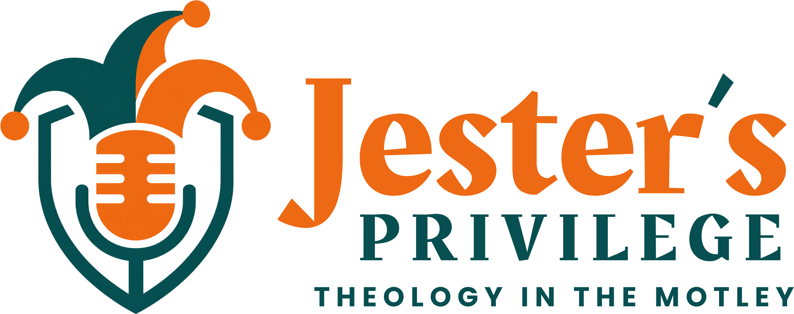
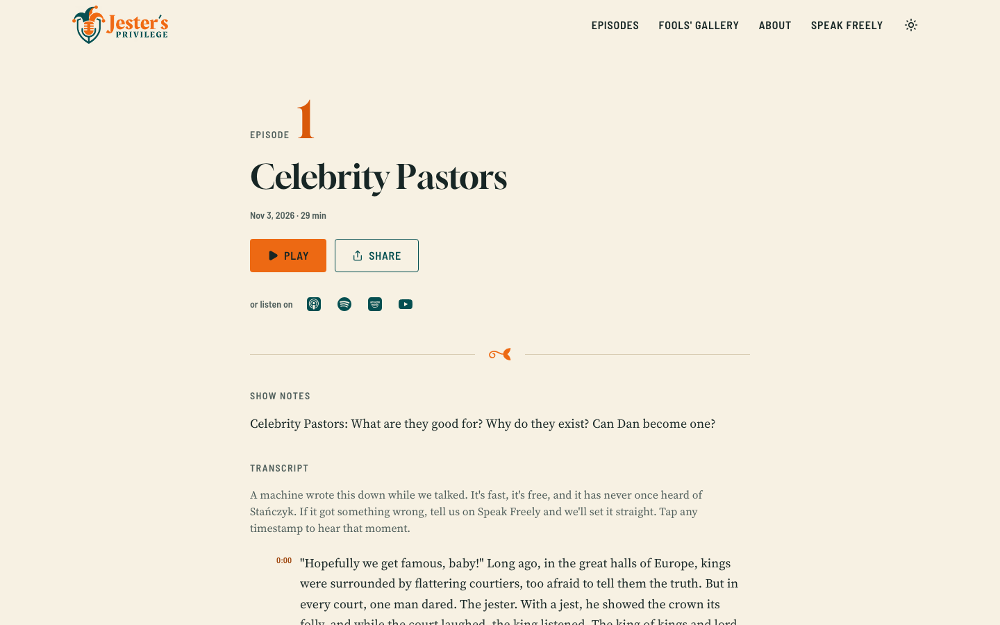

<p align="center">
  <picture>
    <source media="(prefers-color-scheme: dark)" srcset="public/brand/horizontal-tagline-dark.png">
    
  </picture>
</p>

<p align="center">
  <b>A weekly theology-and-humor podcast from three Jesters who serve the King.</b><br>
  <a href="https://jestersprivilegepodcast.com">jestersprivilegepodcast.com</a>
</p>

<p align="center">
  <a href="https://github.com/mbelmear/jesters-privilege/actions/workflows/deploy.yml"></a>
  <a href="https://github.com/mbelmear/jesters-privilege/actions/workflows/ci.yml"></a>
  <a href="https://github.com/mbelmear/jesters-privilege/actions/workflows/nightly.yml"></a>
  <a href="LICENSE"></a>
</p>

# Jester's Privilege

The show's website: a fast, static, mobile-first site built with Next.js and served from a Cloudflare Worker. New Episodes arrive from the Spreaker feed on their own, so nobody touches the site when an Episode is published. What it does and why is in [`docs/spec.md`](docs/spec.md); the words it uses are in [`GLOSSARY.md`](GLOSSARY.md).

You’re welcome to run, fork, and reuse the [MIT-licensed code](LICENSE). The Jesters maintain the upstream project in-house.

<p align="center">
  
  &nbsp;
  
</p>

## What's on the site

- **Home**: the jester story, the latest Episode, a glimpse of the Fools' Gallery, and the Jesters
- **Episodes**: every Episode, playable in place, each with its Show notes and, once transcribed, its Transcript
- **Fools' Gallery**: the history of court jesters and holy fools as a timeline, each Fool with a public-domain painting
- **About**: why the show is called "Jester's Privilege", and who the Jesters are
- **Speak Freely**: where listeners send Questions, Confessions, and Topic ideas
- A persistent player that keeps playing while you browse

## How it's built

How the platform fits together, from the feed to the live site, is in [`docs/architecture.md`](docs/architecture.md).

The site is built agent-first. The Jesters' brief became [`docs/spec.md`](docs/spec.md) in a grilling session, the spec became tickets on GitHub Issues, and coding agents build each ticket test-first in its own git worktree. Every pull request is reviewed against [`CODING_STANDARDS.md`](CODING_STANDARDS.md) and its ticket before it merges, and GitHub's merge button stays shut until a required `PR gate` status says the pull request's head has passed that review. Anything a visitor sees waits for a Jester's approval on a preview deploy. After a ticket ships, a retro turns what went wrong into a check, a script, or a coding standard, so the next ticket starts from a better place. The full rules are in [`AGENTS.md`](AGENTS.md) and [`docs/testing.md`](docs/testing.md).

Three test layers guard it: Jest with React Testing Library and jest-axe for logic and components, Playwright on Chromium and WebKit at phone and desktop sizes, and a Lighthouse CI budget for mobile performance.

## Getting started

Use Node 24, the version in `.nvmrc`: newer versions fail a unit test that passes in CI.

```bash
nvm use
npm install
npm run dev
```

Open [http://localhost:3000](http://localhost:3000).

## Commands

| Command                    | What it does                              |
| -------------------------- | ----------------------------------------- |
| `npm run dev`              | Start the dev server                      |
| `npm run build`            | Export the static site to `out/`          |
| `npm test`                 | Unit and component tests (Jest)           |
| `npm run test:e2e`         | Browser tests against `out/` (Playwright) |
| `npm run lighthouse`       | Mobile performance budget against `out/`  |
| `npm run typecheck`        | Type-check the project                    |
| `npm run format`           | Format everything with Prettier           |
| `npm run pr-status -- <n>` | Wait for PR `<n>`'s checks and preview    |

How each test layer works and how to run it locally: [`docs/testing.md`](docs/testing.md).

## Documentation

| Document                                       | What it covers                                                  |
| ---------------------------------------------- | --------------------------------------------------------------- |
| [`docs/architecture.md`](docs/architecture.md) | How the platform is built and how it works                      |
| [`docs/spec.md`](docs/spec.md)                 | What the site does, page by page, and why                       |
| [`docs/adr/`](docs/adr/)                       | Architecture decisions that are hard to reverse                 |
| [`docs/deploy.md`](docs/deploy.md)             | Deploys, the feed check, Transcripts, Submit, rolling back      |
| [`docs/testing.md`](docs/testing.md)           | Each test layer, CI, and merging                                |
| [`CODING_STANDARDS.md`](CODING_STANDARDS.md)   | How code here is written                                        |
| [`GLOSSARY.md`](GLOSSARY.md)                   | The project's vocabulary                                        |
| [`AGENTS.md`](AGENTS.md)                       | The working rules coding agents follow                          |
| [`CONTRIBUTING.md`](CONTRIBUTING.md)           | Why outside contributions aren't taken, and where to go instead |
| [`SECURITY.md`](SECURITY.md)                   | How to report a vulnerability privately                         |

## Listening, questions, and feedback

To ask the Jesters a Question, send a Confession, or suggest a Topic idea, use [Speak Freely](https://jestersprivilegepodcast.com/speak-freely) on the site, not GitHub Issues. Issues here are the build's own tickets, and the repo doesn't take outside contributions ([`CONTRIBUTING.md`](CONTRIBUTING.md)). If a Transcript gets something wrong, Speak Freely is the place for that too. Report a security problem privately, as [`SECURITY.md`](SECURITY.md) describes.

## License

The code is under the [MIT License](LICENSE). The show's name, logos and artwork, the Jesters' photos, the site's copy, and the Episodes themselves are © the Jesters, all rights reserved. The Fools' paintings are public domain, each with its source in `src/content/paintings.ts`. The fonts keep their own SIL Open Font License.
