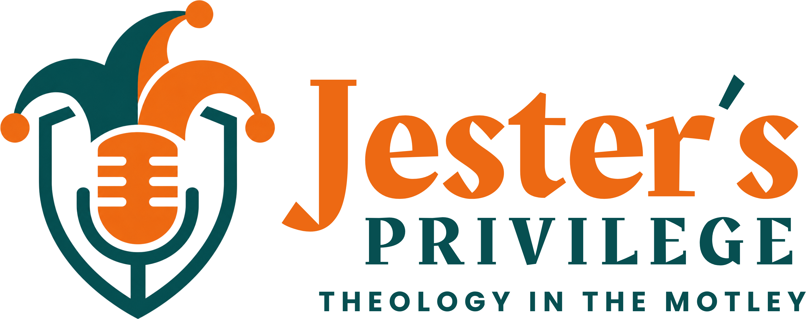

<p align="center">
  <picture>
    <source media="(prefers-color-scheme: dark)" srcset="public/brand/horizontal-tagline-white.png">
    
  </picture>
</p>

<p align="center">
  <b>A weekly theology-and-humor podcast from three Jesters who serve the King.</b><br>
  <a href="https://jestersprivilegepodcast.com">jestersprivilegepodcast.com</a>
</p>

# Jester's Privilege

The show's website: a fast, static, mobile-first site built with Next.js and served from a Cloudflare Worker. New Episodes arrive from the Spreaker feed on their own, so nobody touches the site when an Episode is published. What it does and why is in [`docs/spec.md`](docs/spec.md); the words it uses are in [`GLOSSARY.md`](GLOSSARY.md).

## What's on the site

- **Home**: the jester story, the latest Episode, a glimpse of the Fools' Gallery, and the Jesters
- **Episodes**: every Episode, playable in place, each with its Show notes and Transcript
- **Fools' Gallery**: the history of court jesters and holy fools as a timeline, each Fool with a public-domain painting
- **About**: why the show is called "Jester's Privilege", and who the Jesters are
- **Speak Freely**: where listeners send Questions, Confessions, and Topic ideas
- A persistent player that keeps playing while you browse

## How it's built

The site is built agent-first. The Jesters' brief became [`docs/spec.md`](docs/spec.md) in a grilling session, the spec became tickets on GitHub Issues, and coding agents build each ticket test-first in its own git worktree. Every pull request is reviewed against [`CODING_STANDARDS.md`](CODING_STANDARDS.md) and its ticket before it merges, and `npm run merge` merges only a reviewed commit whose checks all pass. Anything a visitor sees waits for a Jester's approval on a preview deploy. After a ticket ships, a retro turns what went wrong into a check, a script, or a coding standard, so the next ticket starts from a better place.

Three test layers guard it: Jest with React Testing Library and jest-axe for logic and components, Playwright on Chromium and WebKit at phone and desktop sizes, and a Lighthouse CI budget for mobile performance.

## Getting started

```bash
npm install
npm run dev
```

Open [http://localhost:3000](http://localhost:3000).

## Commands

| Command                | What it does                              |
| ---------------------- | ----------------------------------------- |
| `npm run dev`          | Start the dev server                      |
| `npm run build`        | Export the static site to `out/`          |
| `npm test`             | Unit and component tests (Jest)           |
| `npm run test:e2e`     | Browser tests against `out/` (Playwright) |
| `npm run lighthouse`   | Mobile performance budget against `out/`  |
| `npm run typecheck`    | Type-check the project                    |
| `npm run format`       | Format everything with Prettier           |
| `npm run merge -- <n>` | Merge PR `<n>` once reviewed and green    |

How each test layer works and how to run it locally: [`docs/testing.md`](docs/testing.md).
