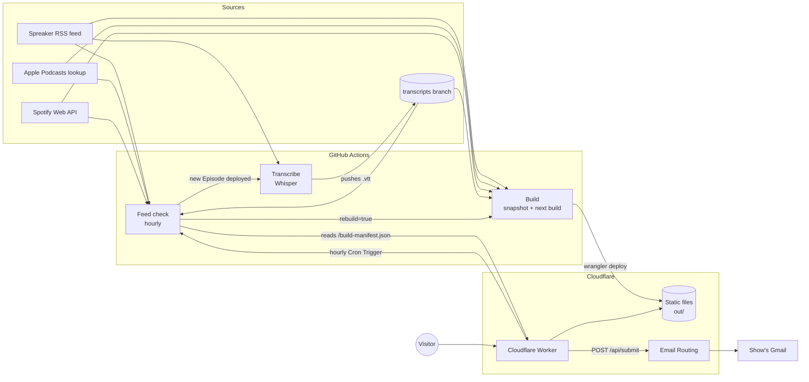
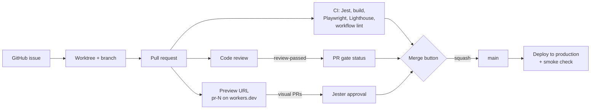

# Architecture

How the Jester's Privilege site is built and how it works, for an engineer new to the repo. What the site does and why is in [`spec.md`](spec.md); the words it uses (Episode, Jester, Fool, Listen link, Transcript) are defined in [`../GLOSSARY.md`](../GLOSSARY.md). This guide maps the system and points into the deeper docs rather than repeating them.

## The shape of it

The site is a **static export**: Next.js renders every page to HTML at build time, and one Cloudflare Worker serves those files. Nothing renders on request. New Episodes reach the site because a GitHub Actions workflow checks the podcast feed every hour and rebuilds when something has changed ([ADR 0001](adr/0001-static-site-rebuilt-on-schedule.md)); the Worker starts that check ([ADR 0004](adr/0004-feed-check-started-by-cloudflare-cron.md)). The Worker's only jobs beyond serving files and starting the feed check are redirecting `www` and accepting listener Submissions.



| Piece       | Technology                                                                         | Where                                         |
| ----------- | ---------------------------------------------------------------------------------- | --------------------------------------------- |
| Pages       | Next.js 16 (App Router, `output: "export"`), React 19, TypeScript, Tailwind CSS v4 | `src/app/`, `src/components/`                 |
| Hosting     | One Cloudflare Worker with static assets, custom domains                           | `wrangler.jsonc`, `src/worker/`               |
| Content     | Typed content files, validated at build time                                       | `src/content/`, `src/lib/content.ts`          |
| Episodes    | The Spreaker RSS feed, read once per build                                         | `src/lib/feed.ts`, `src/lib/episode-feed.ts`  |
| Transcripts | whisper.cpp on GitHub's runners, saved to a `transcripts` branch                   | `.github/workflows/transcribe.yml`            |
| Submissions | The Worker's `POST /api/submit`, Turnstile, Cloudflare email binding               | `src/lib/submit.ts`, `src/worker/adapters.ts` |
| Analytics   | Cloudflare Web Analytics (cookieless), production builds only                      | `src/lib/analytics.ts`                        |
| CI/CD       | GitHub Actions, `wrangler`                                                         | `.github/workflows/`                          |

## From feed to live site

A build runs `npm run build`, which is three steps:

1. **`npm run images`** (`scripts/images.ts`) makes every image the content shows in each width `next/image` may ask for, in AVIF and WebP, plus phone crops around each painting's focal point. A static export has no image server, so `next.config.ts` points `next/image` at these files through a custom loader (`src/lib/image-loader.ts`). Unchanged images are skipped.
2. **`npm run snapshot`** (`scripts/snapshot.ts`) asks the outside world everything the build needs, **once**: the feed, every Episode's Transcript, and each podcast app's lookup of the Episodes. It writes the answer to `.feed-snapshot.json`. Next renders pages in several worker processes, and a network read in each could succeed in one and fail in another, leaving pages that disagree with each other; reading one snapshot rules that out (`src/lib/episode-feed.ts`).
3. **`next build`** renders every page and the build manifest from the content files and the snapshot into `out/`.

Which feed a build reads is the `FEED` environment value (`src/lib/feed-source.ts`): `live` for the Spreaker feed, which deploys, previews, the feed check, Transcribe and `npm run launch-check` read; `fixture` (the default) for `src/content/feed-fixture.xml`, so tests never depend on Spreaker; and `empty` for a feed with no Episodes. A production build that isn't reading the live feed fails.

**The Feed module** (`src/lib/feed.ts`) takes the raw feed text and returns validated Episodes or throws an error naming the Episode and the rule it broke: two full Episodes sharing a number, a full Episode without one, a missing required field. Show notes are sanitized to a small allowlist. A failure fails the build, and the last good deploy stays live.

**Episode addresses** come from the feed's episode number: `/episodes/1`, and `/episodes/bonus/<title-slug>` for unnumbered bonus and trailer Episodes ([ADR 0002](adr/0002-episode-urls-use-episode-number.md)).

**Episode Listen links** open an Episode in each podcast app (`src/lib/episode-listen-links.ts`, `src/lib/spotify-lookup.ts`). Apple's public lookup is matched on the feed GUID; Spotify's Web API on title and release day. Amazon Music and YouTube have no lookup, so their links open the show. A lookup that fails never fails the build: the Episode links to the show and the build log names it.

### The feed check

`.github/workflows/deploy.yml` runs the feed check (`scripts/feed-check.ts`, logic in `src/lib/feed-check.ts`) every hour, started by the Worker's Cron Trigger ([ADR 0004](adr/0004-feed-check-started-by-cloudflare-cron.md)), and every 2 hours on GitHub's schedule, which is the backstop. It builds the record a fresh build would publish and compares it with the live site's `/build-manifest.json` (`src/lib/build-manifest.ts`): the newest Episode's GUID, which Episodes each app lists, and which Episodes have a Transcript. Only when one differs does it rebuild and deploy, so one new Episode costs one deploy, and a new Episode is live within about 1¼ hours. GitHub runs its schedule far less often than it asks, so the scheduled run also fails when the Worker hasn't started a feed check for 3 hours, as when its token has expired. [`deploy.md`](deploy.md) has every trigger and failure mode.

### Transcripts

Spreaker makes no Transcripts, so the site makes its own ([ADR 0003](adr/0003-site-makes-its-own-transcripts.md)). Once a feed check deploys a new Episode, Deploy starts `.github/workflows/transcribe.yml`, which finds Episodes in their first week with neither a feed-linked Transcript nor a saved one, transcribes each once with whisper.cpp, and pushes `<episode-guid>.vtt` to the `transcripts` branch. Builds read that branch, and a run that pushed one then starts Deploy itself, so the Transcript is live within minutes; Transcribe's own schedule retries what a failed run missed, and the feed check catches any Transcript a failed deploy left out. Because an Episode with a saved file is never transcribed again, a hand fix to its file sticks. An older Episode with nothing saved fails a scheduled run rather than spend an hour of Whisper on it; a run started by hand remakes it ([`deploy.md`](deploy.md), Transcripts).

On the page, the Transcript module (`src/lib/transcript.ts`) groups WebVTT cues into timestamped paragraphs. The full text is always in the HTML for search engines; tapping a timestamp seeks the player.

## Serving

`wrangler.jsonc` configures one Worker, `jesters-privilege`, with `out/` as its static assets and `run_worker_first` on, so every request reaches `src/worker/index.ts` first:

- `www.jestersprivilegepodcast.com/<path>` answers with a 301 to the apex.
- `POST /api/submit` goes to the Submit handler.
- Its Cron Trigger (`triggers` in `wrangler.jsonc`, production only) calls `scheduled` every hour, which starts Deploy's feed check through GitHub's API (`src/lib/feed-check-start.ts`, [`deploy.md`](deploy.md), Triggers).
- Everything else is served from `out/`, with the themed 404 page for a missing path.

**Submit** (`src/lib/submit.ts`) validates the Submission, drops honeypot hits silently, verifies the Cloudflare Turnstile token server-side, and sends one email to the show's Gmail through the Worker's `send_email` binding. Nothing is stored. The Turnstile verifier and the email sender are injected (`src/worker/adapters.ts`), so the handler is tested without Cloudflare. The request and response shapes are in [`deploy.md`](deploy.md), Submit endpoint.

## Inside the app

```
src/
  app/          Pages (one folder per address), the root layout, Open Graph cards,
                sitemap, robots, the build manifest, and the style guide
  components/   Site components; ui/ holds the restyled shadcn/ui primitives
  content/      Every word and link a visitor reads, as typed content files
  lib/          Logic: pure functions with I/O injected, tested in tests/unit/lib
  worker/       The Cloudflare Worker and its adapters
  fonts/        Self-hosted subsets of the three typefaces
scripts/        Build steps, workflow entry points, and developer tools
tests/
  unit/         Jest + React Testing Library + jest-axe
  e2e/          Playwright against the built site
docs/           Spec, ADRs, deploy, testing, and this guide
```

**Layers.** Pages in `src/app/` only arrange components. Components render what they're given and hard-code no copy. Logic lives in `src/lib/` as pure functions whose clock, network, audio element, email sender and Turnstile verifier come in as parameters, so tests pass fakes. Scripts in `scripts/` are thin: what a script decides lives in `src/lib/`. Outside data (the feed, WebVTT, the Submit body, `localStorage`) enters as `unknown` and is narrowed by a validator at that boundary ([`CODING_STANDARDS.md`](../CODING_STANDARDS.md)).

**Content.** Every sentence a visitor reads is in `src/content/`, typed by `src/lib/content.ts` and validated when the build loads it (`src/content/index.ts`). Copy still awaiting the Jesters' words is marked `draft: true`: previews show a DRAFT ribbon on pages that use it, and `npm run launch-check` fails while any would go live. A Jester changes a bio, a link, or a Fool's story by editing one content file.

**The player.** The player lives in the root layout, so audio keeps playing across client-side navigation. One player store (`src/lib/player.ts`) owns playback: the current Episode, position, speed, and finished Episodes. Archive rows, Episode pages, the Transcript and the player bar send it commands and render its state. It drives the browser only through thin adapters for the `<audio>` element, the Media Session API (lock-screen controls) and `localStorage` (`src/lib/player-browser.ts`), so it is tested against fakes. Positions are saved per device, which is how a return visit offers to resume.

**Design system.** Colors, fonts, radii, shadows and motion presets are design tokens in `src/app/globals.css`, redefined once for dark mode; lint rejects literal colors anywhere in `src/`. The theme follows the system setting, with a toggle, and is applied before first paint. Three typefaces (Gloock, Source Serif 4, Barlow Semi Condensed) are self-hosted as split subsets so most pages fetch only the small half (`scripts/fonts.ts`). Motion respects reduced motion. `/styleguide` shows every token and component in light and dark.

**Sharing and search.** Each page has its own title, description and canonical URL (`src/lib/seo.ts`), with a sitemap, robots file, JSON-LD for the series and each Episode, and Open Graph cards drawn at build time (`src/app/cards/[...card]/route.ts`).

## How changes ship



Every change is a ticket on GitHub Issues, built test-first in its own git worktree and branch ([`../AGENTS.md`](../AGENTS.md)). A pull request runs the following; one that changes only `docs/**` or top-level Markdown skips the build, Playwright and Lighthouse, and gets no preview:

- **CI** (`.github/workflows/ci.yml`): format, lint, typecheck and Jest; the static build; Playwright on Chromium and WebKit at phone and desktop sizes, with axe scans, against both the fixture and an empty feed; a Lighthouse CI mobile performance budget; and actionlint, zizmor and shellcheck on the workflows and scripts. Firefox runs nightly.
- **A preview** (`deploy.yml`): the PR's build, reading the live feed, uploaded as a preview version of the Worker at its own URL and posted on the PR.
- **The PR gate** (`.github/workflows/pr-gate.yml`): a required status that stays red until the PR's head has a passed review recorded by an account with write access. It runs main's copy of its code, never the PR's, so a PR can't rewrite its own gate.

`main`'s ruleset requires a pull request, squash merges, every CI check and the PR gate, with no bypass. A visual PR also waits for a Jester's approval on the preview. A push to `main` deploys to production and runs a smoke check against the live site (`scripts/smoke-check.sh`). After the merge, the Merge audit workflow checks the review really happened, and Conflict watch flags waiting visual PRs that no longer merge cleanly. How each test layer runs and the full merge procedure: [`testing.md`](testing.md).

When a feed check, a production deploy, Deploy's Start Transcribe, or Nightly fails, a workflow opens an issue naming the failure, or comments on the one still open (`deploy-report.yml`, `nightly.yml`). The next passing feed check closes its own issue; the others are closed by hand, a failed deploy's or Nightly's once a run passes again and Start Transcribe's once Transcribe has run.

## Where to read next

The README's [Documentation](../README.md#documentation) table maps every doc; [`testing.md`](testing.md) has the full CI and merge procedure this guide summarizes.
